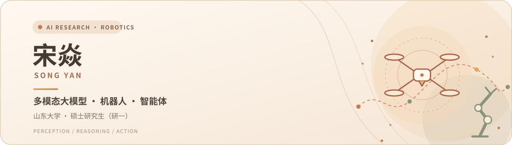
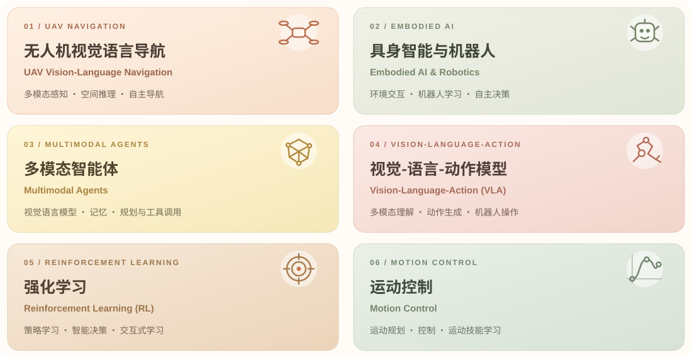

  

 

<h3 align="center">🔬 研究兴趣</h3>

  

 

<h3 align="center">🛠️ 技术栈</h3>

  

 

<h3 align="center">📊 GitHub 数据</h3>

  

 

<h3 align="center">🐍 GitHub 贡献轨迹</h3>

  

 

<h3 align="center">📫 联系我</h3>

  
  &nbsp;
  
  &nbsp;
  
  &nbsp;
  

 

<strong>保持好奇，持续探索。</strong>

