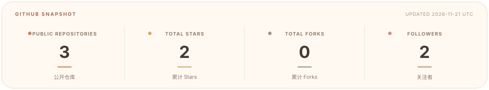

  

---

## 🔬 研究兴趣

  

---

## 🛠️ 技术栈

  

---

## 📊 GitHub 数据

  

## 🐍 GitHub 贡献轨迹

  

---

## 📫 联系我

  <a href="https://github.com/TriIgnis">🐙 GitHub · TriIgnis</a>
  &nbsp;&nbsp;·&nbsp;&nbsp;
  <a href="mailto:trifire_37@163.com">✉️ 邮箱 · trifire_37@163.com</a>
  &nbsp;&nbsp;·&nbsp;&nbsp;
  <a href="https://b23.tv/N03QILa">📺 Bilibili</a>
  &nbsp;&nbsp;·&nbsp;&nbsp;
  🎵 抖音 · TriFire_37

---

**保持好奇，持续探索。**

